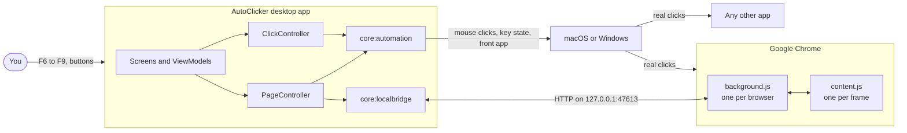
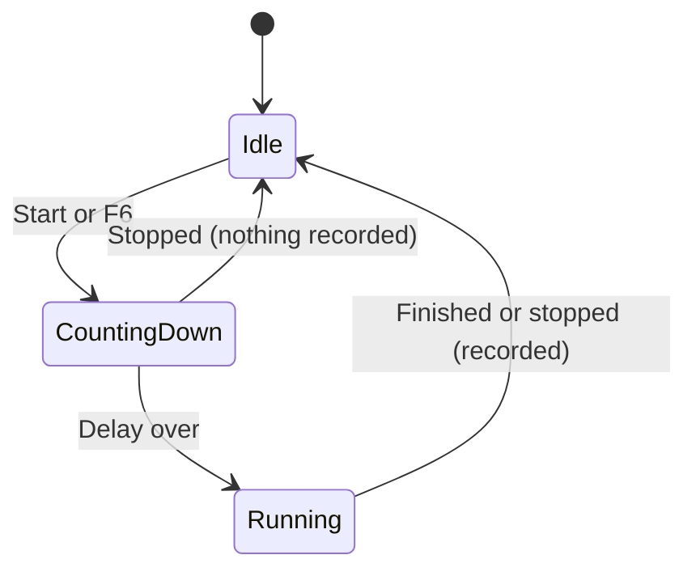
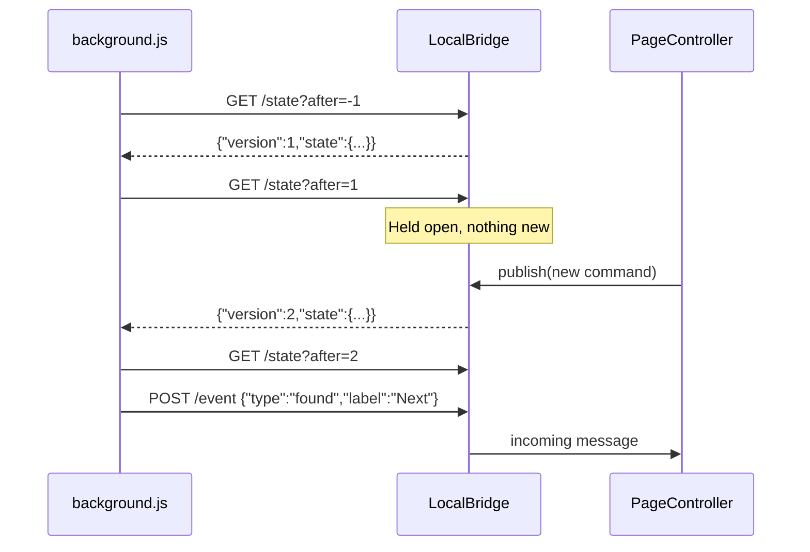
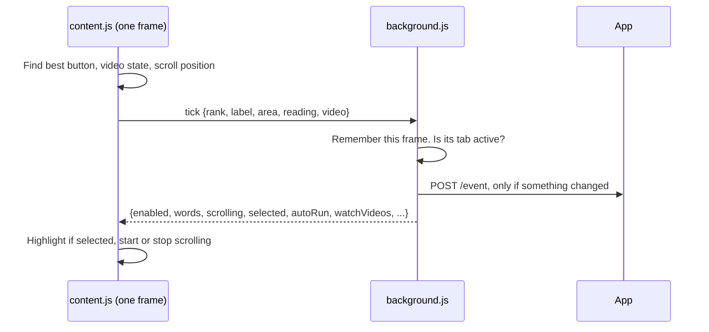
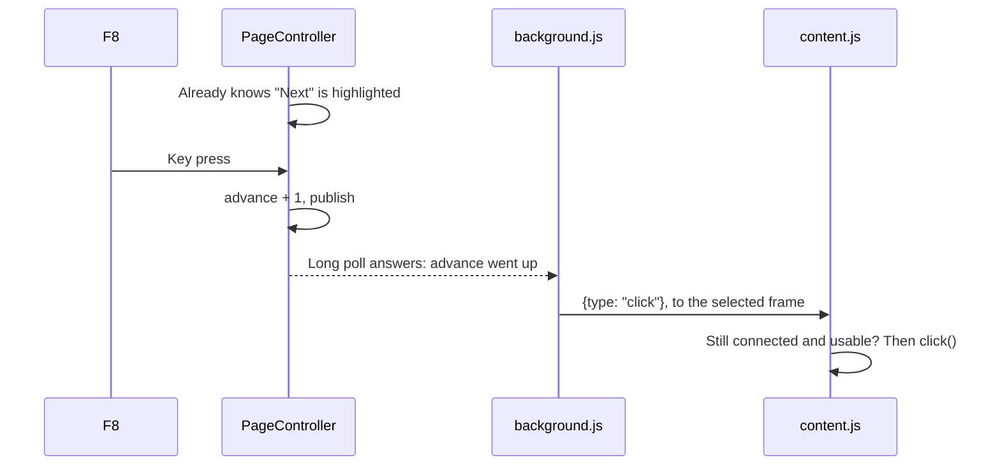
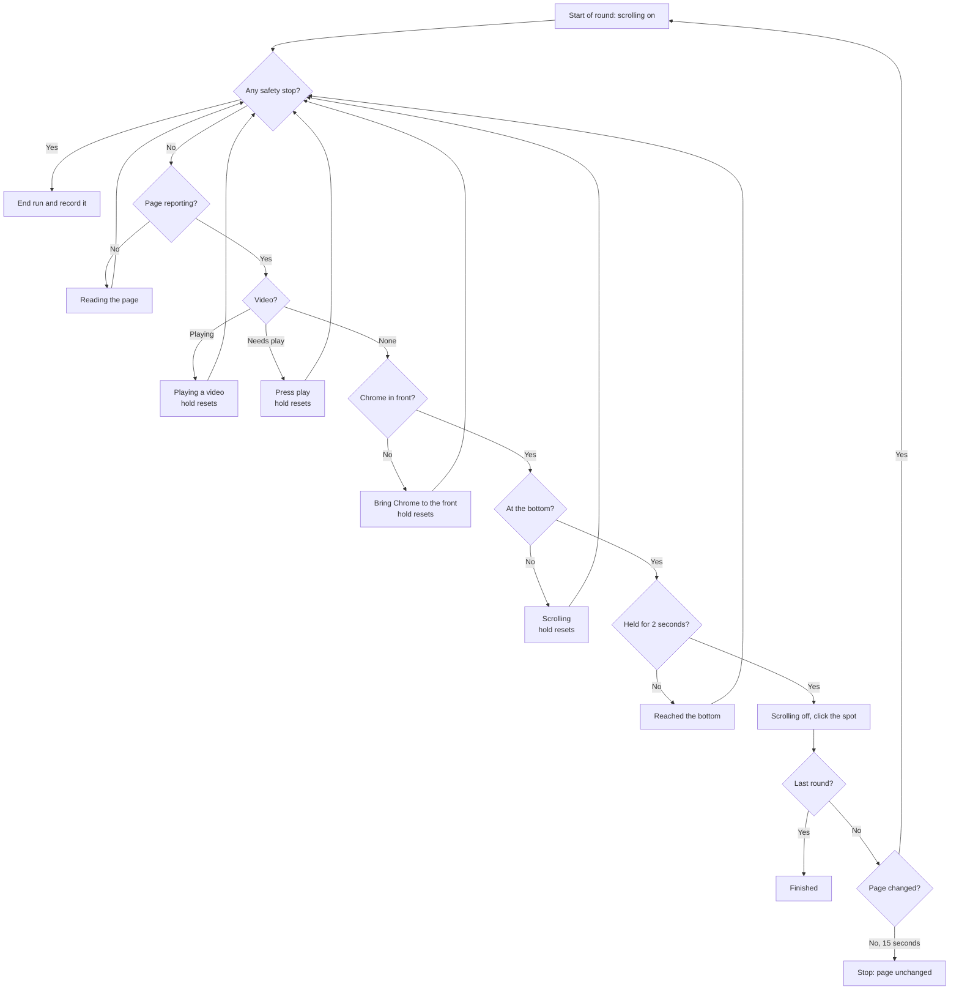

# 13 — How AutoPilot works

[All guides](00_INDEX.md)

This document follows the app from launch to the last click: what each part does, how the parts talk to each other, and how the app talks to Chrome. For setup and build commands, see the [README](../../README.md).

## Contents

1. The big picture
2. Project layout
3. What happens at launch
4. Talking to the operating system
5. Hot keys
6. Routines: the clicker
7. How the app talks to Chrome
8. The Chrome extension
9. Page helper by hand
10. Scroll and click, step by step
11. Videos, step by step
12. Every way a run can stop
13. What gets saved, and where
14. Screens, ViewModels and navigation
15. Privacy and security
16. Build, install and release
17. Testing
18. Limits and troubleshooting
19. Timings and limits reference

---

## 1. The big picture

AutoClicker does two different kinds of work:

| | Clicker (routines) | Page helper (Chrome) |
| --- | --- | --- |
| **Works in** | Any app | Chrome only |
| **Knows about** | Screen positions only | The page: buttons, scrolling, videos |
| **Clicks by** | The operating system, at a screen position | A key press (extension), or the operating system in a Scroll and click run |
| **Needs the extension** | No | Yes |

This split exists because of one limit: **the desktop app can't see inside a web page.** It knows where the pointer is and which app is in front, but not whether a page has reached the bottom or has a video on it. Only code running inside Chrome can see that, which is why there's an extension. In turn, the extension can't press F-keys from other apps or click outside the page, so the two work as a pair.



---

## 2. Project layout

The project uses Kotlin Multiplatform and Compose Multiplatform. Modules depend in one direction: `composeApp` uses features, and features use core modules. A feature never uses another concrete feature; `verifyFeatureModuleBoundaries` enforces that part in the build.

| Module | Job |
| --- | --- |
| `composeApp` | The app shell: `main.kt`, `App.kt`, `AppServices.kt`, navigation, saved-file setup, and the bundled extension |
| `core:automation` | The only code that touches the mouse, keyboard state, Accessibility permission and front app |
| `core:localbridge` | The HTTP link to a trusted local client. It carries JSON and doesn't interpret it |
| `core:persistence` | `PreferencesStore`, backed by DataStore |
| `core:ui` | Theme, palettes, scaffold, app bars, toasts, navigation helpers |
| `core:common`, `core:logger` | Platform and time helpers, logging |
| `core:network`, `core:notifications`, `core:transfer` | Inherited from the template and not used by this app |
| `feature:home` | The Routines tab: every kind of routine, the editor, `ClickController` and `ClickRun` for click routines, `PageController` and `ScrollClickRun` for Chrome routines |
| `feature:activity` | The Activity tab and its history store |
| `feature:settings` | The Settings tab |
| `feature:shared` | `AppPreferences`, `RunRecord`, `RunOutcome`, `RunHistoryStore`, used by several features |
| `iosApp` | iOS entry point. The app opens there and says it's desktop-only |

The template's core modules are kept identical to the Zynk template. That's why the root build pins a `zynk.*` resource package for `core:ui`, and why the template's spare `RouteTopLevel.Sync` route is left unused.

### Routine types

The Routines page lists every routine, whatever its kind, and **New routine** asks which kind to create. Each kind is a `Routine` subtype in `ClickRoutine.kt`, saved with a `type` field:

| Kind | Saved as | Runs in | What it does |
| --- | --- | --- | --- |
| Click routine | `ClickRoutine` (`click`) with the pointer as its target | `ClickController` with `ClickRun` | Clicks wherever the pointer is, in any app (section 6) |
| Multi-point click | `ClickRoutine` (`click`) with a list of points | `ClickController` with `ClickRun` | Clicks a list of steps in order, each with its own wait and button, once or repeated |
| Scroll and click | `ScrollClickRoutine` (`scrollClick`) | `PageController` with `ScrollClickRun` | Scrolls a Chrome page to the bottom, plays videos, clicks a spot, repeats (section 10) |
| Web page helper | `PageHelperRoutine` (`pageHelper`) | `PageController` | Highlights the next button in Chrome while it runs; F8 clicks it and F9 scrolls (section 9) |
| Course helper | `CourseHelperRoutine` (`courseHelper`) | `PageController` | For sagarmeinyog.com: outlines the next unfinished part or Back to Course; each key press opens it (Course helper) |

To add a kind: add a `Routine` subtype and a `RoutineKind` entry, teach `RoutineDraft` to edit it, add its editor section, and give it a runner that `ClickController.start` hands it to. Routines saved before kinds existed have no `type` and load as click routines.

---

## 3. What happens at launch

1. **`main.kt`** starts logging and opens the desktop window, restoring its size and position. `DesktopTitleBar` fits the window to the desktop shell: on a Mac the title bar is see-through with the content running under it, so the app's toolbar shares the row with the system's window buttons (as in Android Studio), and `apple.awt.application.appearance=system` keeps those buttons in the Mac's light or dark style. On Windows, one custom toolbar row contains the app identity and caption controls. `WindowsNativeCaption` retains the native resizable-frame and caption capabilities Windows uses for Snap Layouts, while removing the extra native title row. It exposes the maximize control to native Windows hit testing and empty caption space for dragging and double-click maximize/restore. Resize edges retain their native behavior. Other controls retain their regular app input. The app icon navigates Home. `DesktopCaptionClicks` handles unconsumed double-clicks without taking drag or button gestures.
2. **`App.kt`** runs and calls `AppServices.get()`, which creates the process-wide services once.
3. **`AppServices`** creates, in order:
   - the preference store, for settings
   - `DesktopAutomation`, which starts the hot-key polling loop
   - the routine repository and the history store
   - `LocalBridge`, which starts the HTTP server on `127.0.0.1:47613`
   - `PageController`, which runs Chrome routines and publishes its first state to the extension
   - `ClickController`
4. **The theme waits for settings.** `App` draws nothing until the saved theme is read, so the app never flashes the wrong colours.
5. **The scaffold and navigation appear**, with three tabs: Routines, Activity and Settings. The Chrome extension's setup is in Settings.

The controllers live in `AppServices`, not in a screen, because hot keys and running routines have to keep working whichever tab is open.

**On close:** `AppServices.shutdown()` stops any routine, cancels all background work (which also ends a Scroll and click run), closes the server and stops hot-key polling. Because the process is exiting, recording the interrupted run is best effort.

**If the port is taken:** another program, usually a second copy of AutoClicker, may hold port 47613. Click routines still work, but a selected Chrome routine shows "Can't reach Chrome" on the Routines page and won't start.

---

## 4. Talking to the operating system

Everything goes through the small interfaces in `DesktopAutomation.kt`, so the rest of the app doesn't know which operating system it's on:

| Interface | What it does | macOS | Windows |
| --- | --- | --- | --- |
| `PointerDevice` | Read the position, click, detect corners and the app's own window | Java AWT `Robot` | Java AWT `Robot` |
| `InputAccessGate` | Check and ask for permission | `AXIsProcessTrusted` (Accessibility) | Always granted |
| `HotKeyMonitor` | Report key presses | `CGEventSourceKeyState`, polled | `GetAsyncKeyState`, polled |
| `ForegroundApps` | Name the front app, list apps, bring an app forward | `lsappinfo`, `open -a` | Win32 calls, `SetForegroundWindow` |
| `DesktopAutomation.setDisplayAwake` | Stop the display sleeping | `caffeinate -d` | `SetThreadExecutionState` |

Linux, Android and iOS use `UnsupportedDesktopAutomation`, where every action reports that it did nothing.

**How a click is sent (`AwtPointerDevice`):**

1. Move the pointer to the point, then wait 5 ms. With no point, it re-sends the current position, because on macOS `Robot` otherwise presses at the last place it moved to.
2. Press, hold for 5 ms, release. The short hold matters because some pages ignore a press and release in the same instant.
3. For a double click, wait 30 ms and repeat.

**Keeping the display on:** with the Settings switch on, `AppServices` watches the running state and holds the display awake only while a routine (including its countdown), auto-scroll or a Scroll and click run is going. It lets go when that ends, and the display then sleeps as usual. On a Mac, `caffeinate -w` is tied to the app's process, so a crash can't leave the display awake. It doesn't stop you locking the screen or closing a laptop lid, and clicks can't reach a locked screen.

**macOS permission:** without Accessibility, `Robot` fails silently, so the app checks before starting and asks if needed. The installed app isn't properly code-signed, so macOS may treat each new build as a different app, and the permission often has to be granted again after a reinstall. A run from the IDE or Terminal uses that program's permission instead.

---

## 5. Hot keys

| Default key | Job | Handled by |
| --- | --- | --- |
| F6 | Start or stop the selected routine; stop a Scroll and click run | `ClickController` |
| F7 | Record the pointer position while picking | Both controllers, when they're picking |
| F8 | Click the highlighted button | `PageController` |
| F9 | Start or stop auto-scroll; stop a Scroll and click run | `PageController` |

**How keys are detected:** `PollingHotKeyMonitor` asks the operating system every 30 ms whether each of F1 to F12 is down. `HotKeyEdgeDetector` turns that into single presses, so holding a key counts once, and a key already held when polling starts doesn't count.

This is deliberately not a keyboard hook. It only ever looks at function keys, so it can't see what you type. It also means **the key isn't swallowed**, so the app in front receives it too.

**Only one routine runs at a time.** Every kind of routine starts and stops through `ClickController`, which runs click routines itself and hands Chrome routines to `PageController`. `start()` does nothing while any routine runs, so two can never move the pointer at once.

**F6 never does two things at once:** if any routine runs, F6 only stops it. Press it again to start the selected routine.

Settings refuses to give one key two jobs, and explains the clash.

---

## 6. Routines: the clicker

### What a routine holds

`ClickRoutine` stores a name, a target (the pointer, or a list of points), a button, single or double click, an interval, a random extra wait, a stop limit, an optional "only in this app", and a start delay.

**A routine with points is a multi-point click.** `ClickRoutine.kind` comes from its target, so both kinds share one saved type and one runner, and routines saved before the split need no change. The editor shows each kind its own sections: a multi-point click lists its steps as one-line rows that open for editing, with **Pick again** to re-pick one step's spot, and a **Repeat** section (Once, a number of times, until stopped, for a set time).

**Points run as a sequence.** Each `ClickPoint` can carry its own `delayMillis` (the wait before its click, counted from the click before it) and its own `button`. The very first click comes straight after the start delay; on a repeat, the first point's wait follows the last point's click. A point saved before these existed uses the routine's interval and button, and the editor shows those values so they can be changed. The editor's arrows reorder the points. `RunLimit.Passes(n)` stops after the list has run `n` times, so 1 runs it once.

The editor keeps numbers as text in `RoutineDraft`, so half-typed values aren't lost. `validate()` checks them, and `toRoutine()` builds the routine once they pass.

### Picking points

`RoutineEditorViewModel.startCapture()` listens to `ClickController.captures`. Each F7 press adds the current pointer position as a point, so you can pick several without returning to the app.

### Running one



`ClickController` owns the state. `start()` checks permission, then sets `CountingDown` *before* launching the work, so a second key press can't start a second run. It counts down one second at a time, then hands over to `ClickRun`.

### The click loop (`ClickRun.execute`)

Each pass does the following:

1. Finish if the limit is reached.
2. Run the **safety checks** (section 12).
3. Work out the next point, and check whether it should wait:
   - **Wrong app in front** (`WaitingForApp`), when "only in this app" is set.
   - **On its own window** (`OverOwnWindow`), when the click would land on AutoClicker's focused window. This keeps Stop reachable.
   - While waiting it forgets where it last put the pointer, because you may move the mouse to switch apps.
4. Click, count it, and move to the next point, wrapping back to the first.
5. Wait for the interval plus any random extra. It waits in slices of up to 50 ms and re-checks safety each time, so a long interval never delays a stop.

When the run ends, `ClickController` writes a `RunRecord` to history, even if it was cancelled.

---

## 7. How the app talks to Chrome

### The transport

The app runs a tiny HTTP server (`JvmLocalBridge`, built on the JDK's `HttpServer`) on `127.0.0.1:47613`. Loopback means it can only be reached from this computer. The extension is always the one that connects, because a browser extension can't accept incoming connections.

There are two endpoints:

| Endpoint | Direction | Purpose |
| --- | --- | --- |
| `GET /state?after=N` | App → extension | Long poll: "give me the latest commands" |
| `POST /event` | Extension → app | "Here's something that happened", as JSON, up to 16 KB |

### Long polling

`GET /state` tells the app the last version the extension has seen:

- If the app has something newer, it answers straight away.
- If not, it **holds the request open for up to 20 seconds**, and answers the moment `publish()` is called.
- The extension then immediately asks again.

So a command reaches Chrome almost instantly without constant requests. The app compares with "not equal" rather than "greater than", so an extension still holding a version from before an app restart catches up.



### Who counts as connected

The bridge reports `connected` while a poll is waiting, or if it heard from the extension in the last 5 seconds. So when Chrome closes, the app notices within about 5 seconds.

### What the app sends: `HelperCommand`

```json
{
  "enabled": true,
  "scrolling": true,
  "pixelsPerSecond": 60,
  "words": ["Next", "Continue", "Play", "Watch video"],
  "advance": 3,
  "autoRun": true,
  "watchVideos": true
}
```

| Field | Meaning |
| --- | --- |
| `enabled` | The page helper is on. When off, the extension does nothing |
| `scrolling` | Scroll the page now |
| `pixelsPerSecond` | Scroll speed |
| `words` | Button words to look for, most important first |
| `advance` | A **count** of F8 presses. See below |
| `autoRun` | A Scroll and click run is going, so report where the page is |
| `watchVideos` | Stop for videos during that run |

**Why `advance` is a count and not "click now":** state is replaced, not queued, and the extension can reconnect at any time. It clicks only when it sees the number *go up* from one reading to the next. When the link drops it forgets the number, so presses from before reconnecting can never fire later.

### What the extension sends: events

| Event | Example | Meaning |
| --- | --- | --- |
| `found` | `{"type":"found","label":"Next"}` | The button now highlighted, or `null` for none |
| `videoEnded` | `{"type":"videoEnded"}` | A video ended in the active tab, so the app may play its alert |
| `page` | `{"type":"page","focused":true,"atBottom":true,"signature":"…","video":"none"}` | During a run: where the page is |

The app ignores anything malformed or unknown.

### How the link is secured

There's no password. Instead it relies on headers that the browser sets and page scripts can't change (`JvmLocalBridge.isAllowed`):

- A request with an `Origin` header is accepted only if it's exactly `chrome-extension://mdnfpmhkcnalejgjenhnlnogkonicboa`.
- Chrome sends no `Origin` on the extension's own GET, so a request without one must carry `Sec-Fetch-Site: none` and `Sec-Fetch-Mode: cors`.
- Anything else gets a 403.

That extension ID is fixed by the public `key` in `manifest.json`, and `BrowserExtensionTest` checks that the two match.

This stops **web pages** from driving the app. It doesn't stop **another program already on your computer**, which could send the same headers. Such a program could read the helper's settings or send false events, such as a fake "at the bottom", but that program would already be running on your machine. The port itself is set in `manifest.json`, `background.js` and `BrowserExtension.kt`, and a test checks they agree.

---

## 8. The Chrome extension

The files are in `composeApp/src/jvmMain/resources/chrome-extension/` and ship inside the app. **Show extension folder** copies them to `~/.autoclicker/chrome-extension`, and Chrome loads them from there as an unpacked extension.

**Permissions:** `alarms`, plus `host_permissions` for `127.0.0.1:47613` only. `content.js` runs on all pages, because the helper has to work on whichever page you're using. A test confirms the only address in the scripts is the local one.

### Two scripts, two roles

| | `background.js` | `content.js` |
| --- | --- | --- |
| **Runs** | Once, as a Chrome service worker | Separately in every frame of every page, iframes included |
| **Can see the page** | No | Yes |
| **Can reach the app** | Yes | No, not directly |
| **Job** | The link to the app, and choosing which frame acts | Find buttons and videos, scroll, click |

They exchange Chrome messages. Each `content.js` sends a `tick`, and `background.js` answers with what that frame should do.

### The tick

Every frame sends a tick every **700 ms** when the helper is on, and every **2 seconds** when it's off:



Tabs that aren't active are told `enabled: false`, so background tabs do nothing.

### Choosing between frames

A page can have many frames, so `background.js` keeps a record of each (entries older than 3 seconds are ignored) and picks:

- **The button:** the frame reporting the best match for your words.
- **The scroller:** the frame with the largest scrollable area. Only this frame scrolls and reports the page's position.
- **Videos:** any frame's video holds up the whole page, because videos often sit in their own iframe.

### Finding a button (`findButton`)

1. Look through the page, including shadow DOM, for clickable things: buttons, links, `[onclick]`, `[role="button"]`, and so on.
2. Skip anything disabled, invisible, or with a label over 40 characters.
3. Rank by your word order. An exact label beats a word inside a longer label.

### Scrolling

`scrollStep` runs once per screen frame and adds up `pixelsPerSecond × time passed`, carrying the fraction over so slow speeds stay smooth. `findScroller` picks the largest scrollable element in the frame, which may be the page or a panel inside it.

### Staying alive

Chrome stops idle service workers after about 30 seconds. To avoid that, the worker makes a harmless API call every 20 seconds, and a one-minute alarm restarts it if Chrome stops it anyway.

### Reloading the extension

Reloading cuts off the `content.js` already running in open tabs, and Chrome doesn't inject the new one until the tab is refreshed. **So after a reload, refresh the page.** Until you do, a run shows "Reading the page", because nothing is reporting.

---

## 9. Page helper by hand

**Pressing F8:**



The controller ignores F8 unless a page helper routine is running and a button is highlighted. The extension re-checks the button just before clicking. Some pages ignore this kind of scripted click.

**Pressing F9:** flips `isScrolling` and publishes. The scrolling frame starts or stops within one tick.

**Video alert:** `content.js` listens for `ended` on each video and passes it on. If the switch is on, the app plays the system alert.

---

## 10. Scroll and click, step by step

This mode scrolls to the bottom, clicks the spot you picked, waits for the page to change, and repeats. The app makes the click, through the operating system, so it works on any page element. The logic is in `ScrollClickRun`, and `PageController` wires it up.

### Starting

1. **Picking:** in the routine's editor, press **Pick steps on screen** and press F7 over each spot to click at the bottom, in order. These are the routine's `points`, edited with the same step rows as a multi-point click: name, wait, spot and button. At the bottom, the first step waits its own wait after the page settles; each later step waits after the click before it, and nothing is clicked while Chrome isn't in front. A routine saved with a single `point` reads it as one step.
   A step can instead be a **button text** (`ClickPoint.text`). Then the app sends `clickText` with a new `clickRequest` number; every frame looks for a visible, enabled button or link with that label; `background.js` has the best match clicked once (a scripted click, found again at the moment of clicking) and reports `textClicked` with the request number. The run waits up to 30 seconds, counting only while Chrome is in front, then stops with "a button wasn't found". The pointer isn't moved for these steps.
2. **Checks:** `PageController.start()` needs the extension connected and input permission, and `ClickController` only calls it when no routine is running. If something's missing, it shows the reason and doesn't start.
3. **State:** it sets the activity and `isScrolling` *before* launching, so a second press can't start a second run, then publishes with `autoRun: true`.
4. **Chrome comes forward:** `bringToFront("Google Chrome")` runs `open -a` on a Mac, and calls `SetForegroundWindow` on the most recent Chrome window on Windows.

### One round



The status line in the app shows the phase names above.

**Why it waits 2 seconds at the bottom:** pages often load more content as you reach the end. If the page grows, it's no longer at the bottom, the timer resets, and scrolling carries on. Infinite feeds therefore never trigger a click.

**Why it clicks on a fresh reading:** the decision to click uses the latest report with no wait in between. On top of that, `background.js` tells the app the moment Chrome loses focus (`windows.onFocusChanged`) instead of waiting for the next tick. Both reduce the chance of a click landing in another app.

### How "at the bottom" is worked out

The frame doing the scrolling runs `readPage()`. It counts as at the bottom when all of these hold:

- `document.readyState` is `complete`, so a loading page doesn't count. After 15 seconds it stops waiting, so a stuck iframe can't hold a run forever.
- `scrollTop + clientHeight` is within 2 pixels of `scrollHeight`, or there's nothing to scroll, or scrolling hasn't moved the page for 3 seconds. That last check covers pages that report more content than they let you reach.

If no frame scrolls, the top frame reports instead.

### How "the page changed" is worked out

Each frame's `readPage()` also hashes its address, page height, text length, up to 200,000 characters of text, and its image addresses. `background.js` combines every frame's hashes into one **signature**, because many pages keep their content in an iframe while the top frame never changes. The app gets a single hash, never the address, text or images.

After a click, the page counts as changed if any of these is true:

- The signature differs.
- The page is no longer at the bottom.
- A video has started.

If none happens within 15 seconds while Chrome is in front, the run stops with "the click didn't change the page", rather than clicking a dead end up to the round limit. Time with Chrome in the background doesn't count.

---

## 11. Videos, step by step

With **Stop for videos** on, `content.js` does this on each tick (`checkVideos`):

1. **Find videos worth watching.** It skips `loop` videos, muted autoplay videos, live streams and hidden ones, because those are decoration or never end.
2. **Notice when one is reached.** An `IntersectionObserver` fires when a quarter of a video is on screen. The video is remembered as reached, so a fast scroll past it still stops for it.
3. **Handle the first reached video that isn't done:**

| Video state | What happens | Reports |
| --- | --- | --- |
| Already playing | Wait | `playing` |
| Finished | Move to the next video | |
| Not started yet | Centre it and call `play()` | `playing` |
| Started, now paused | Leave it alone, because pausing is your choice | `needsPlay` |

4. **If no real video needs anything,** look for a play button (below).

`background.js` combines all frames into one state, and turns scrolling off for the page while it's anything but `none`. The app sees the same state in the `page` event and won't click. Moving the pointer doesn't end the run while a video plays, so you can use the player's controls.

**A finished video** means `ended` is set, or playback is within 0.5 seconds of the end, because some players pause just before it. A video that starts playing again counts as playing again, which covers players reusing one element for several clips.

**Speed:** the code never changes playback speed and never seeks.

### Chrome's autoplay rules

Chrome can refuse to start a video with sound unless you've interacted with the site. A refusal shows "Press play on the video in Chrome", and the run waits for you. Clicking once on the page before starting makes this less likely.

### Pictures with a play button

Many players show a picture and a button, and only create the `<video>` once it's pressed. Until then there's nothing to play. So when no real video needs attention, `pressPlayControl` looks for a control that:

- is on screen, visible, and at least 16 pixels in size
- has a label, title, class or ID that looks like *play* (for example `big-play-button`)
- doesn't look like pause, stop, next, previous, again, all or playlist

It presses that control **once**, so an ended video isn't started over, and holds the page for 8 seconds while the player loads. If no video appears, scrolling carries on.

This is a scripted click, so **some players ignore it**, and Chrome's autoplay rules can still apply. In that case, press play yourself when the page stops. It's also the only click the extension makes without a key press, and only in a run you started with the switch on.

---

## 12. Every way a run can stop

| Trigger | Routine | Scroll and click | Recorded as |
| --- | --- | --- | --- |
| Limit or last round reached | Yes | Yes | Finished |
| Stop button or F6 | Yes | Yes | Stopped by you |
| F9 | No | Yes | Stopped by you |
| Pointer in a screen corner (within 4 pixels) | Yes | Yes | Stopped at a screen corner |
| Pointer moved by hand (more than 3 pixels from where the app put it) | With fixed points | After a click | Stopped because you moved the pointer |
| Accessibility turned off | Yes | Yes | Input permission was turned off |
| Click couldn't be sent | Yes | Yes | A click couldn't be sent |
| Page unchanged for 15 seconds | No | Yes | The click didn't change the page |
| Chrome closed, or helper turned off | No | Yes | Chrome closed or the helper was turned off |

**Pointer-moved details:**

- A routine that clicks at the pointer never has this stop, since the pointer is expected to be yours.
- Scroll and click has it only after its first click, and it doesn't apply during a video or while waiting for Chrome. If you moved the pointer during those, the check restarts after the next click.

The corner and pointer-moved stops can be turned off in Settings. A routine cancelled during its countdown isn't recorded, because nothing ran.

---

## 13. What gets saved, and where

On desktop, data is stored in `~/.autoclicker/` using DataStore files.

| File | Holds | Format |
| --- | --- | --- |
| `app_preferences.preferences_pb` | Theme, palette, hot keys, safety switches, keep-display-on | Separate keys |
| `routines.preferences_pb` | Routines and the selected one | One JSON document |
| `run_history.preferences_pb` | The newest 200 runs | One JSON document |
| `page_helper.preferences_pb` | Helper on or off, words, speed, click spot, rounds, video switch | One JSON document |
| `chrome-extension/` | A copy of the extension for Chrome to load | Files |

The window's size and position are stored separately, in Java Preferences under `com/jagdeep/autoclicker/window`.

Room is set up by the template but not used. Absent or unknown saved values fall back to defaults, and unreadable documents are treated as empty. The first launch creates one ready-to-use routine.

**Routine files:** **Export** on a routine, or **Export all**, writes a readable JSON file (`RoutineFileCodec`) naming itself `autoclicker-routines`, version 1, with each routine in the same shape the app saves. **Import** reads one back through the system's Open panel: each routine gets a new id, so nothing of the user's is replaced, and must pass the editor's own checks, so a damaged or hand-edited file can't add, for example, a 0 ms interval. Files over 2 million characters, other formats and unknown routine kinds are refused. The file dialogs are `DesktopRoutineFiles` in `composeApp`; phones don't offer import or export.

**Uninstalling:** delete `/Applications/AutoClicker.app`, `~/.autoclicker`, and the extension in `chrome://extensions`. To clear the permission entry, run `tccutil reset Accessibility com.jagdeep.autoclicker`.

---

## 14. Screens, ViewModels and navigation

Every tab follows the same pattern:

```text
Screen  →  sends user events     →  ViewModel  →  Controller or store
Screen  ←  renders one UI state  ←  ViewModel  ←  flows
```

- **Screens** receive a ViewModel and callbacks, and do no I/O.
- **ViewModels** expose one `StateFlow` of immutable state.
- **Entry providers** (`*NavEntries.kt`) build the ViewModels from what `AppNavHost` passes in, so features stay independent.
- **Controllers outlive screens.** Leaving a tab destroys nothing that matters to a run.

| Tab | ViewModel | Notes |
| --- | --- | --- |
| Routines | `HomeViewModel` | Rechecks permission every 2 seconds while it's missing, so allowing it in System Settings shows up by itself |
| Routine editor | `RoutineEditorViewModel` | Holds the draft and pointer capture, with a section for each kind of routine. Its route holds only the routine's ID, or the kind of a new one |
| Activity | `ActivityViewModel` | Shows history, and asks before clearing it |
| Settings | `SettingsViewModel` | Rejects a hot key already in use, and shows the extension's setup and connection |

Desktop uses `DesktopShell` in `composeApp`, laid out like Android Studio: a toolbar (app name, a routine picker with Start and Stop, Chrome's status) in the title bar row, a narrow icon strip for the pages, the page in a rounded panel, and a status bar. `ShellModel` feeds the toolbar from the same `ClickController` and routines as the Routines page, so both always agree. Pages change with a fade. Phones use `TopLevelPager` with swiping, though the app itself is desktop-only for now.

---

### Course helper

A hands-on routine for one site, sagarmeinyog.com, built on the web page helper's key-press clicking. While it runs, the command carries `course: true`, and `content.js` uses `findCourseTarget` instead of word matching:

- On the dashboard (`/dashboard`), the first course card that doesn't show "Completed" has its round play button outlined (a card is the nearest container showing "Min. Pass" and "Duration").
- On a course page (`/dashboard/courses/<id>`), the first **Watch video** button whose row isn't completed, or else the header of a closed chapter (`aria-expanded="false"`), is outlined. Row status is read from the row's text without relying on word breaks.
- On a lesson (`/dashboard/courses/<id>/<part>`), its `<video>` is started once, at the site's own speed, and **Back to Course** is outlined when it appears.
- Each press of the click key clicks the outlined element once, exactly as the web page helper does. Play buttons are never pressed by the helper itself, and quizzes and the assessment are never outlined.

It acts only on that site (and on `127.0.0.1` for the extension's own tests).

### Developer mode's live log

With **Developer mode** on in Settings, Activity gains a **Live log** view, next to **Runs**. It shows each step as it happens, with millisecond times:

| Source | Logged by | Examples |
| --- | --- | --- |
| Chrome | `PageController` | Extension connected or not, every command sent (`→`, raw JSON, only when it changes), every message heard (`←`, raw JSON) |
| Routine | `ClickController`, `PageController` | Started, refused and why, phase and round changes, pauses, ended with the outcome |
| Click | both runners | Each click, and where |
| Keys | both runners | Each hot key pressed, and what it did |
| App | `AppServices` | Developer mode on, Chrome brought forward, display kept on or released |

The log is `LiveLog` in `feature:shared`, implemented by `MemoryLiveLog` in `composeApp`. It keeps the newest 500 entries in memory only, never saved or sent anywhere. Recording happens only while the switch is on, and the `log { }` helper doesn't even build the text otherwise. **Pause** freezes the view for reading, **Copy** puts the whole log on the clipboard, and **Clear** empties it.

## 15. Privacy and security

**No outside connections.** The app and extension contact nothing but each other, on this computer. There's no account, analytics or telemetry.

**What reaches the app from a page:**

| Sent | Not sent |
| --- | --- |
| The highlighted button's label, up to 40 characters, which developer mode's log also shows | Page text in general |
| Whether Chrome is in front, the page is at the bottom, and a video is playing | Page addresses |
| Hashes for spotting a change | Passwords, form contents, anything you type |

**What's stored:** routine names and screen positions, timings, run counts and stop reasons, and your settings. History doesn't record screen contents or the page you were on. Nothing here is encrypted, as none of it is meant to be secret.

**Clicking without a key press:** routines and Scroll and click runs both click on their own once you start them, on whatever is at that screen position. The extension's own clicks need a key press, with one exception, the play button described in section 11.

**Use on courses and tests:** the page helper's hands-on mode is designed for working through pages yourself. It doesn't answer questions or get around course checks. Scroll and click isn't meant for completing recorded training with nobody there.

---

## 16. Build, install and release

```shell
./gradlew :composeApp:run                 # run from source
./gradlew :composeApp:packageReleaseDmg   # build the Mac installer
```

The DMG is written to `composeApp/build/compose/binaries/main-release/dmg/`. The version is in `gradle/libs.versions.toml`, and the extension has its own in `manifest.json`.

**After installing a new build:**

1. Allow Accessibility again if asked, or if clicks do nothing.
2. Press reload on the extension in `chrome://extensions`. Press **Show extension folder** first if the files need updating.
3. Refresh any open page.

Only one copy can hold the port, so quit the installed app before running from source.

**Windows, Linux and Intel Mac installers** come from `.github/workflows/desktop-packages.yml`. A manual run builds Windows, `-f platforms=all` adds the others, and a `v*` tag builds everything. Installers aren't code-signed, so macOS and Windows warn on first launch.

---

## 17. Testing

```shell
./gradlew jvmTest verifyFeatureModuleBoundaries
```

| Level | Examples | Covers |
| --- | --- | --- |
| Logic with fakes | `ClickRunTest`, `ClickControllerTest`, `PageControllerTest` | Run behaviour, safety stops, timing on a virtual clock |
| Storage | `PreferencesRoutineRepositoryTest`, `ActivityTest` | Saving and reading back |
| Link | `JvmLocalBridgeTest` | Long polling and header checks |
| Screens | `*ScreenUiTest`, `HomeScreensUiTest` | What each state shows. Set `UI_TEST_SHOT_DIR` to save images |
| Wiring | `AppWiringTest`, `BrowserExtensionTest` | Registration, extension ID, port agreement, permissions |

Two tests are opt-in because they do real things:

```shell
# Runs the extension's scripts in headless Chrome, with a throwaway profile.
AUTOCLICKER_LIVE_CHROME_TEST="/Applications/Google Chrome.app/Contents/MacOS/Google Chrome" \
  ./gradlew :composeApp:jvmTest --tests '*LiveChromeExtensionTest*' --rerun

# Sends real clicks and a key press to its own window. Keep your hands off the mouse.
AUTOCLICKER_LIVE_INPUT_TEST=1 ./gradlew :core:automation:jvmTest --tests '*LiveInputTest*' --rerun
```

**What the automated tests can't prove:**

- Branded Chrome won't load an extension from the command line, so the live test uses stand-ins for the `chrome.*` APIs and fake video playback.
- Real autoplay rules, real sound, real players, and the extension loaded through `chrome://extensions` all need a person to try.
- The Windows code compiles but has never run.

---

## 18. Limits and troubleshooting

### Limits

- **Clicks go to a screen position.** Moving or resizing the Chrome window, or a layout shift, means a saved spot hits something else.
- **The spot isn't checked against the window.** The run checks that Chrome is in front, but a spot outside Chrome's window, or under another window, still gets clicked.
- **Chrome only.** `bringToFront` names Google Chrome, and other browsers aren't supported.
- **Pages with always-changing content,** like a clock, always look changed, so only the round limit stops the run.
- **Slow pages:** over 15 seconds to change after a click stops the run.
- **Videos:** canvas players and others without a standard `<video>` can't be seen, and a stalled video holds the run until you stop it.
- **One saved spot:** the same point is used every round.
- **Administrator apps on Windows** can't be clicked.

### Troubleshooting

| You see | Likely cause | Fix |
| --- | --- | --- |
| "Waiting for Chrome" | Chrome is closed, or the extension isn't added or is off | Open Chrome and check `chrome://extensions` |
| "Can't reach Chrome", port in use | Another copy of the app is running | Quit it and reopen |
| "Allow access" won't go away | The old permission belongs to an earlier build | Remove AutoClicker from the Accessibility list, add it again, reopen the app |
| Clicks do nothing | Same as above | Same as above |
| "Reading the page" stays | The tab wasn't refreshed after a reload, or the page can't run extensions (such as `chrome://` pages or the Chrome Web Store) | Refresh, or use another page |
| "Bring Chrome to the front" | Another app, including AutoClicker, is in front | Click Chrome and leave it there |
| "Press play on the video in Chrome" | Chrome blocked autoplay, or the video was paused | Press play once |
| Scrolls past a video | The player has no standard video, or its button wasn't recognised | Turn the speed down, or press play yourself |
| Scrolling, but nothing moves | It chose the wrong scrollable area | Please report the page |
| Stops soon after a click | The click missed, or the page took over 15 seconds | Pick the spot again |
| Run ends as soon as you touch the mouse | The pointer-moved stop | Keep your hands off, or turn it off in Settings |
| F-keys don't work on a Mac | They're acting as media keys | Hold fn, or change the setting in macOS |

---

## 19. Timings and limits reference

| Value | Amount | Where |
| --- | --- | --- |
| Hot-key polling | 30 ms | `PollingHotKeyMonitor` |
| Front-app cache | 250 ms | `CachedForegroundApps` |
| Click: settle, hold, between clicks | 5, 5, 30 ms | `AwtPointerDevice` |
| Routine safety check | 50 ms | `ClickRun` |
| Routine re-check while waiting | 200 ms | `ClickRun` |
| Interval | 10 ms to 24 hours | `RoutineDraft` |
| Random extra wait | Up to 1 hour | `RoutineDraft` |
| Start delay | 0 to 60 seconds, default 3 | `RoutineDraft` |
| Limit | Up to 1,000,000,000 clicks or 7 days | `RoutineDraft` |
| Long poll hold | 20 seconds | `JvmLocalBridge` |
| Connected grace period | 5 seconds | `JvmLocalBridge` |
| Maximum event size | 16 KB | `JvmLocalBridge` |
| Content tick, on and off | 700 ms, 2 seconds | `content.js` |
| Frame record lifetime | 3 seconds | `background.js` |
| Service worker keep-alive | 20 seconds, plus a 1-minute alarm | `background.js` |
| Bottom tolerance | 2 pixels | `content.js` |
| No movement counted as the bottom | 3 seconds | `content.js` |
| Longest wait for a page to finish loading | 15 seconds | `content.js` |
| Video counted as on screen | 25% visible | `content.js` |
| Video end tolerance | 0.5 seconds | `content.js` |
| Wait after pressing a play button | 8 seconds | `content.js` |
| Scroll speed | 10 to 400 pixels a second, default 60 | `ClickRoutine.kt` |
| Rounds | 1 to 9,999, default 20 | `ClickRoutine.kt` |
| Scroll and click check | 50 ms | `ScrollClickRun` |
| Hold at the bottom | 2 seconds | `ScrollClickRun` |
| Page change timeout | 15 seconds | `ScrollClickRun` |
| History kept | 200 runs | `PreferencesRunHistoryStore` |
| Link port | 47613 | `BrowserExtension.kt` |

## Assessment modes and learning order

Sagar Mein Yog stores assessment mode and learning order separately. With **Videos first**, the routine waits for a single confirmation after all available videos are complete before beginning the assessment pass, including in Automatic mode. Select **Assessment after each module** to handle assessments as each module's videos finish.

- **Automatic:** starts, answers saved exact matches, and submits unfinished assessments. A saved unsubmitted status does not by itself add a start approval. Unknown answers pause for help. A failed assessment still requires an explicit retry choice.
- **Review approvals:** saved answers are available, but starts and submissions require approval.
- **Manual:** approved starts work without an answer-bank match; the user supplies answers and approves submission.

No assessment is started merely by opening AutoPilot. Run the saved routine to apply its options.
